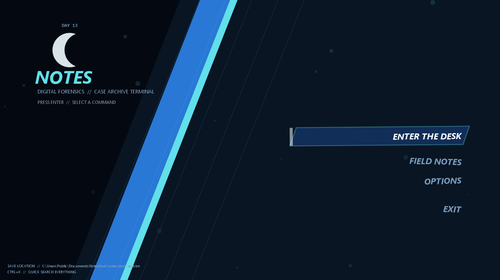
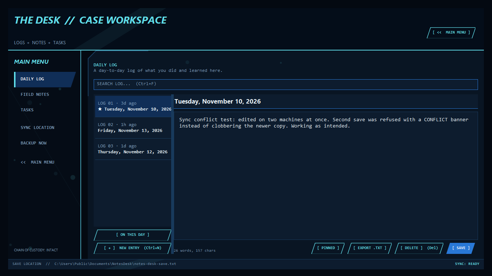
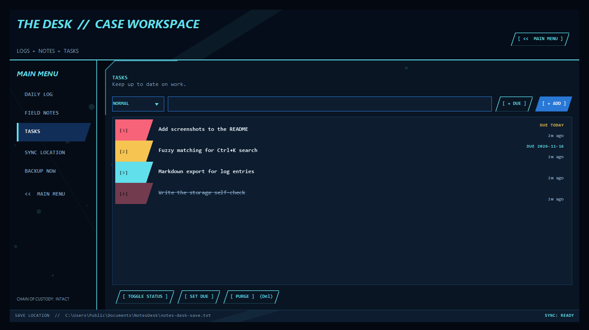
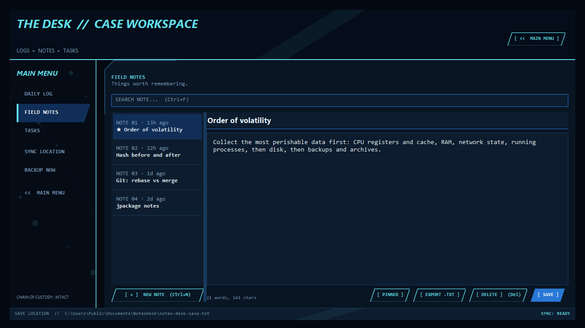

# Notes Desk

A local-first desktop notebook built in pure Java Swing. It keeps a dated daily log, a reference
notebook, and a task queue in one place, with Ctrl+K search across all of them. It can sync between
computers through any folder your cloud client already syncs, with no server and no account.

The whole UI is hand-painted with `Graphics2D`: angled panels, animated transitions, and custom list
renderers. There are no image assets and no third-party dependencies, only Java SE.



## Features

- **Daily Log.** A searchable, editable journal. New entries are titled with today's date, and
  **On This Day** brings up entries from the same date in earlier months. You can pin entries,
  export one to `.txt`, and undo a delete with Ctrl+Z.
- **Field Notes.** A second notebook for reference material, with the same search, pin, and export.
- **Tasks.** Priorities (high/normal/low), due dates from a quick-pick menu, overdue highlighting,
  and automatic ordering: active tasks by due date first, finished tasks at the bottom.
- **Ctrl+K quick search.** A command-palette search across every log entry, note, and task. Pick a
  result and it opens straight to that item.
- **Serverless sync.** Point the app at any folder two machines share (OneDrive, Google Drive,
  Dropbox, a network drive). The two machines don't need the same provider, only the same folder.
- **Conflict-safe saves.** Writes are atomic (temp file, then move). If another machine changed
  the file since it was last read, the app refuses to overwrite it and reports a conflict instead.
  A malformed line is skipped rather than throwing away the whole file.
- **Offline and private.** No network calls, no telemetry, no account.
- **Native packaging.** `package.bat` uses `jlink` and `jpackage` to build a standalone
  `NotesDesk.exe` with a trimmed runtime, so the target machine doesn't need Java installed.

## Screenshots

| Daily Log | Tasks |
|---|---|
|  |  |

| Field Notes |
|---|
|  |

## Build and run

Requires **JDK 17+** on `PATH`. Maven is optional.

```bash
./build.sh                    # macOS / Linux / Git Bash
java -jar target/notes-desk.jar
```

```bat
build.bat                     :: Windows
java -jar target\notes-desk.jar
package.bat                   :: optional: standalone dist\NotesDesk\NotesDesk.exe
```

Both build scripts compile the app, run the storage self-check (`StorageTest`), and package
`target/notes-desk.jar`. With Maven installed, `mvn package` produces the same jar.

### Where data is stored

The app looks for a save location in this order:

1. `-Dnotesdesk.dir=<folder>` JVM option
2. `NOTES_DESK_SAVE_DIR` environment variable
3. The folder chosen in-app with **Sync Location**
4. An auto-detected OneDrive / Google Drive / Dropbox folder (`<root>/NotesDesk`)
5. `~/.notes-desk/`

**Backup Now** writes a timestamped copy to a `backups/` folder next to the save file.

## Keyboard shortcuts

| Keys | Action |
|---|---|
| Ctrl+K | Search everything |
| Ctrl+N | New entry / focus the new-task box |
| Ctrl+F | Search the current list |
| Del | Delete the selected item |
| Ctrl+Z | Undo the last delete |

## Project layout

```
src/main/java/com/notesdesk/
  Main.java              frame, screen switching, autosave, Ctrl+K wiring
  Storage.java           save-file format, sync-folder resolution, conflict detection
  NotebookPanel.java     list + editor used by Daily Log and Field Notes
  TaskPanel.java         task queue, due dates, custom row renderer
  QuickSearchDialog.java Ctrl+K palette
  Pulse.java             one shared animation timer for every animated component
  Theme.java, Angled*.java, WipeTransition.java, ...   hand-painted UI components
src/test/java/com/notesdesk/StorageTest.java          save-format self-check
```

## Design notes

- **One animation clock.** Every hover glow, selection flash, and transition subscribes to a
  single `Pulse` timer instead of running its own `javax.swing.Timer`.
- **Plain-text storage.** The save file is pipe-delimited and escaped, one record per line. It
  stays readable, diffs cleanly, and survives a sync client writing half a file.
- The visual style takes its cues from stylized game menus (diagonal cuts, a black and light-blue
  palette). Every shape is drawn in code.

## License

MIT. See [LICENSE](LICENSE).
